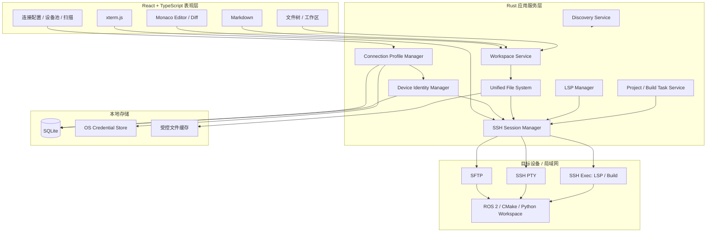
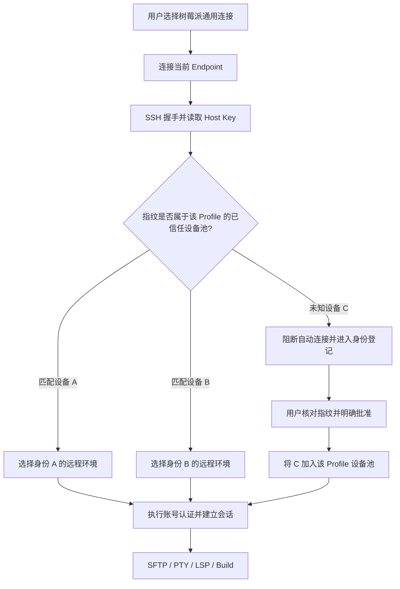
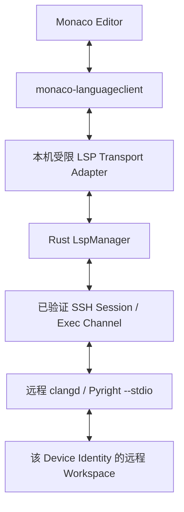
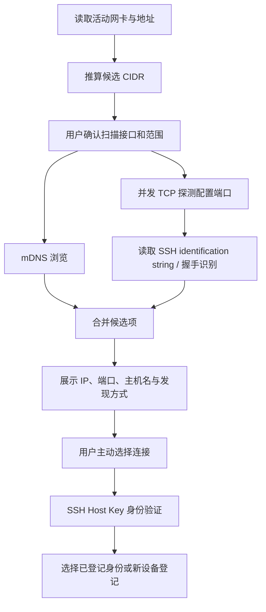

# 文档说明

**文档版本：** 3.0  
**适用平台：** Windows / macOS  
**主要场景：** 本地代码与 Markdown 编辑、局域网 SSH、远程文件管理、终端、工程构建与远程语言智能  
**技术主线：** Tauri 2 + React + TypeScript + Rust + Monaco Editor + SSH / SFTP + LSP  
**本次重点：** 引入“连接配置、网络端点、设备身份、远程工程环境”四层分离模型，支持同一 IP 轮流连接多台不同设备。

> 本文不预设或指定最终产品名称。文中“开发工作台”“本项目”均指正在规划的跨平台桌面开发工具。

## 本版相对前版的关键调整

1. 明确采用 Monaco Editor 作为主代码编辑器，CodeMirror 不再作为主编辑器路线。
2. 将离线能力定义为不依赖互联网、云服务、账号服务或远程中继；本地电脑与目标设备之间仍须有局域网或其他可用网络链路。
3. 将 SSH 连接配置与设备身份拆开：一个连接配置可以授权多个 SSH Host Key 指纹，适配多台树莓派轮流使用同一个 IP 的场景。
4. 不因 IP、用户名或密码相同就认定设备相同；设备身份以经验证的 SSH Host Key 为核心。
5. 增加设备池模式、首次登记、未知身份阻断、密钥变更处理和克隆镜像密钥唯一化要求。
6. 文件缓存、远程 LSP、编译数据库与工程环境按设备身份和工作区隔离，不能只按 IP 缓存。
7. 明确远程 LSP 通过 SSH 无 PTY 的 exec/stdin/stdout 通道传输；交互终端使用独立 PTY 通道。
8. 实施计划增加设备池切换、纯局域网、断网和身份安全专项验收。

## 文档导航

| 章节 | 内容 |
|---|---|
| 01 | 项目目标、范围与离线定义 |
| 02 | 技术选型与关键决策 |
| 03 | 总体架构与模块边界 |
| 04 | SSH 连接配置、设备身份与设备池设计 |
| 05 | 离线 SSH、SFTP 与远程文件工作区 |
| 06 | Monaco、远程 LSP 与工程上下文 |
| 07 | 终端、构建任务与错误定位 |
| 08 | 局域网设备发现与 IP 搜索 |
| 09 | 数据模型与安全存储 |
| 10 | 跨平台、离线部署与发布 |
| 11 | 工程目录、接口与状态管理 |
| 12 | 测试、验收与风险控制 |
| 13 | 分阶段实施计划 |
| 附录 | 决策记录、配置示例与参考资料 |

---

# 01 项目目标、范围与离线定义

## 1.1 项目目标

本项目是一款面向 Windows 和 macOS 的桌面工程开发工作台。它以本机为控制中心，统一处理本地文件、远程 Linux 设备、代码编辑、Markdown、SSH 终端、SFTP 文件传输、局域网设备发现和工程任务。

核心目标不是复刻完整的通用 IDE，而是减少工程师在多个工具之间切换的成本：发现目标设备、建立可信连接、打开远程工程、编辑文件、执行构建、查看日志并定位错误，应尽可能在同一应用内完成。

## 1.2 典型使用场景

| 场景 | 用户动作 | 期望结果 |
|---|---|---|
| 本地开发 | 打开项目目录，编辑 C++、Python、YAML、XML、Shell 等文件 | Monaco 编辑、多标签、搜索、Diff、保存和工作区恢复 |
| Markdown | 编辑 README、开发笔记和技术文档 | 源码编辑、实时预览、目录、相对图片与链接支持 |
| 局域网设备 | 扫描网段或手动输入 IP / 端口 | 发现候选 SSH 服务，用户选择设备后连接 |
| 远程开发 | 通过 SSH/SFTP 打开树莓派或 Linux 主机上的工程 | 同一编辑器完成远程读取、编辑、保存和冲突处理 |
| 设备轮换 | 多台树莓派使用相同 IP、账号和密码，但不同时在线 | 一个连接配置可识别多台已登记设备，不反复误报 Host Key 变化 |
| 工程构建 | 在远程终端运行 `colcon build`、测试或启动节点 | 输出可查看，编译错误可跳转到对应文件与行列 |
| 远程语言智能 | 远程工程使用 clangd / Pyright 等服务 | 补全、悬停、定义跳转、诊断等功能基于目标设备真实环境工作 |

## 1.3 产品范围与优先级

| 优先级 | 功能范围 | 说明 |
|---|---|---|
| P0 | 本地文件树、Monaco、Markdown、SSH 密码/密钥认证、SFTP、交互终端、连接配置、Host Key 校验 | 首先形成可以日常使用的本地与远程编辑闭环 |
| P1 | 设备池、多设备身份登记、局域网发现、远程文件冲突检测、工程任务、终端错误跳转 | 解决设备轮换和工程工作流痛点 |
| P1 | 远程 C++ / Python LSP、ROS 2 / CMake / Python 工程识别 | 提升专业开发体验 |
| P2 | Git 图形界面、调试器、插件机制、端口转发、更多语言服务和容器功能 | 根据真实使用需求逐步增加 |

首版不以完整替代 VS Code、JetBrains IDE 或开发服务器管理平台为目标；不自研编译器和语言分析引擎；不要求云账号、云服务器或公网中继。

## 1.4 “离线可用”的准确边界

**离线 SSH 不等于没有网络。** SSH 通过 TCP 网络连接工作，局域网、直连网线、热点或其他可用 IP 网络都可以承载 SSH；互联网不是必要条件。完全没有本机到目标设备的网络链路时，SSH 无法连接。SSH 传输层提供加密、完整性与服务器身份认证，用户认证则属于更高层协议。[1]

| 功能 | 是否依赖互联网 | 必要条件 |
|---|---|---|
| 应用启动、界面、Monaco 基础编辑 | 否 | 静态资源与 Worker 随安装包提供 |
| 本地文件、Markdown、搜索 | 否 | 本地文件权限 |
| 局域网 SSH / SFTP / 终端 | 否 | 有效网络路径、目标 SSH 服务可达 |
| 局域网 IP 扫描、mDNS | 否 | 当前网段允许组播或 TCP 探测 |
| 远程 LSP | 否 | 目标设备已经安装并可运行对应语言服务器 |
| 首次下载语言服务器或依赖 | 可能需要 | 可在联网时准备，也可使用离线安装包手动部署 |
| 云同步、在线插件市场 | 不纳入核心要求 | 首版不实现或明确标记为可选扩展 |

**离线验收标准：** 在关闭互联网出口但保留局域网通信的环境中，应用可以启动、本地编辑、连接已配置设备、验证 Host Key、使用 SFTP 和终端，并运行目标设备上预先安装的远程语言服务器。应用不得因离线而强制登录或访问云服务。

---

# 02 技术选型与关键决策

## 2.1 推荐技术栈

| 层次 | 技术选择 | 主要职责 |
|---|---|---|
| 桌面框架 | Tauri 2 | Windows/macOS 桌面容器、窗口、菜单、权限与安装包 |
| 前端 | React + TypeScript | 工作区、面板、状态和交互 |
| UI 组件 | Tailwind CSS + shadcn/ui（可选） | 侧边栏、对话框、列表、菜单和主题 |
| 代码编辑器 | Monaco Editor ESM | 代码编辑、Model、多标签、Diff、快捷键 |
| 语言协议客户端 | monaco-languageclient + LSP | 将编辑器与语言服务器能力连接起来 |
| Markdown | Markdown parser + DOMPurify | 文档解析、预览和 HTML 安全处理 |
| 终端显示 | xterm.js | 终端绘制、输入、颜色、滚动和尺寸 |
| 本地后端 | Rust + Tokio | SSH、SFTP、网络发现、文件、任务和并发 |
| SSH | russh（候选实现） | SSH 握手、认证、Channel、exec、PTY |
| SFTP | russh-sftp（候选实现） | 远程目录与文件读写 |
| 局域网发现 | mdns-sd + TCP connect scan | mDNS/DNS-SD 发现与受控范围端口探测 |
| 数据库 | SQLite | 非敏感配置、工作区元数据、身份登记和缓存索引 |
| 凭据存储 | macOS Keychain / Windows Credential Manager | 保存密码、私钥口令和其他秘密凭据 |

库版本在实施时重新核对兼容矩阵并锁定 lockfile。russh / russh-sftp 应通过真实 Raspberry Pi 和 OpenSSH 服务器进行互操作测试；不能只依据示例代码判断兼容性。[3][8]

## 2.2 为什么采用 Tauri 2

Tauri 让 Web 前端负责界面、Rust 负责系统能力。相比 Electron，应用可以避免把完整 Chromium 与 Node.js 运行时作为桌面壳的默认组合；相比 Flutter，Monaco、xterm.js 和 Web 编辑器生态集成更直接。需要接受的代价是系统 WebView 差异、Rust 学习成本，以及 Windows WebView2 和 macOS WKWebView 必须分别验证。

Tauri 的 capabilities 应遵循最小权限原则，只暴露界面真正需要的命令与资源范围。[9]

## 2.3 编辑器决策：Monaco Editor

主编辑器选择 Monaco，原因是本项目更重视日常编辑效率和工程工作流，不将“最轻量”作为第一目标。Monaco 提供成熟的编辑器交互、编辑命令、多光标、折叠、查找替换、快捷键和 Diff Editor；CodeMirror 6 仍可用于未来某些轻量文本控件，但不作为主代码编辑器。

| 维度 | CodeMirror 6 | Monaco Editor | 本项目取舍 |
|---|---|---|---|
| 开箱体验 | 模块化，较多功能需组合扩展 | 更接近主流专业 IDE 的编辑器体验 | 选 Monaco，减少自行拼装 |
| 可定制性 | 高 | 高，但内部模型与扩展方式有自身约束 | 两者都能定制，不作为决定因素 |
| Diff | 通常需额外组合 | 有 Diff Editor | 远程版本对比场景有价值 |
| 语言智能 | 需接入语言服务 | 同样需接入 LSP | 不把 Monaco 等同于完整 VS Code |
| 集成成本 | 基础包可较轻 | Worker、CSP、资源路径需要认真配置 | 先做跨平台技术验证 |
| 最终决策 | 不作为主编辑器 | 作为主编辑器 | 以真实任务效率和稳定性验收 |

Monaco 本身不是完整 VS Code，也不会自动提供所有 VS Code 扩展、调试器和语言生态。C++、ROS 2、Python 等工程语义能力需要独立接入语言服务器。

## 2.4 Monaco 集成边界

- 使用 Monaco ESM 版本，按官方集成说明配置 Vite Worker，并将相关 Worker 随应用资源打包；不得依赖 CDN 才能加载编辑器。[4]
- 封装统一的 React EditorHost，集中管理 Editor、Model、Disposable、主题、快捷键和语言注册。
- 同一资源只创建一个稳定 Model；不同设备即使远程路径相同，也必须使用不同的 Model URI。
- 采用延迟加载语言贡献和语言服务器；编辑器本体与 LSP 服务生命周期分离。
- 对超大文件设置阈值、只读或降级策略，阈值通过性能测试决定。
- Windows WebView2 与 macOS WKWebView 分别测试 Worker、中文输入法、剪贴板、快捷键、高 DPI 和长文件。

## 2.5 关键架构决策摘要

| 编号 | 决策 | 理由 |
|---|---|---|
| ADR-001 | 本地优先、无云端硬依赖 | 满足局域网与无互联网环境 |
| ADR-002 | Monaco 作为主编辑器 | 优先保证代码编辑体验 |
| ADR-003 | SSH Profile 与 Device Identity 分离 | 同一端点可轮换不同设备 |
| ADR-004 | 设备池按已批准 Host Key 列表授权 | 不以 IP 或账号密码代替服务器身份 |
| ADR-005 | 远程文件、环境和 LSP 按设备身份隔离 | 防止同 IP 设备之间缓存串用 |
| ADR-006 | PTY 与 LSP exec 通道分离 | 避免终端回显污染 LSP JSON-RPC |
| ADR-007 | 未知或变化的 Host Key 不自动接受 | 防止中间人攻击与误连设备 |

---

# 03 总体架构与模块边界

## 3.1 逻辑架构



## 3.2 模块职责

| 模块 | 职责 | 不负责的事情 |
|---|---|---|
| Connection Profile Manager | 保存连接入口、端口、用户名、认证引用、设备池策略 | 不把 IP 当设备唯一身份 |
| Device Identity Manager | 验证 Host Key、管理指纹授权、设备别名和身份状态 | 不负责网络扫描或用户密码认证 |
| SSH Session Manager | 管理 SSH transport、认证、Channel、断线和重连 | 不负责编辑器 UI |
| Unified File System | 提供本地与 SFTP 统一读写接口 | 不把远端路径转换为本机路径 |
| Workspace Service | 管理本地/远程工作区、文档 URI 和标签页 | 不直接实现 SSH 协议 |
| LSP Manager | 按设备身份和工作区启动、复用、关闭语言服务器 | 不猜测远程依赖环境 |
| Project Service | 识别 ROS 2、CMake、Python 等工程结构 | 不未经确认执行构建命令 |
| Build Task Service | 运行任务、记录 cwd、输出和问题匹配 | 不吞掉原始终端输出 |
| Discovery Service | mDNS、网段、端口探测与候选设备展示 | 不自动认证或信任 Host Key |
| Secret Store | 保存密码、私钥口令等凭据 | 不在 SQLite 或日志中存明文 |

## 3.3 四个必须分离的概念

这是设备轮换场景下最重要的数据模型原则：

| 概念 | 含义 | 示例 | 是否稳定 |
|---|---|---|---|
| 网络端点 Endpoint | 当前连接地址和端口 | `192.168.1.100:22` | 可能变化，也可能被多台设备轮流使用 |
| 连接配置 Connection Profile | 用户保存的登录方式和策略 | “树莓派通用连接” | 用户配置稳定 |
| 设备身份 Device Identity | 经验证的 SSH 服务器公钥指纹 | `SHA256:...` | 通常随设备 SSH Host Key 生命周期稳定；重新生成密钥后会改变 |
| 远程工程环境 Remote Environment | 某台设备某个工作区的 OS、架构、ROS 发行版、工具版本与路径 | 设备 B 的 `/home/pi/ros2_ws` | 绑定设备身份和工作区 |

此外，**SSH Session 是一次运行时连接实例**，拥有 session_id、打开的 Channel 和状态；它不是持久设备身份。

## 3.4 数据流与 IPC

Tauri Commands 适合短请求/响应，例如读取文件、打开连接、保存配置；Events 或 Tauri Channel 适合长时间输出，如终端数据、扫描结果和文件传输进度。每个长任务都应有 task_id 或 session_id，并支持取消。

| 操作 | 机制 | 示例 |
|---|---|---|
| 读取文件 / 列目录 | Command | `read_resource(uri)` / `list_directory(uri)` |
| SSH 连接 | Command 创建 session_id，Event 推送状态 | `connect_profile(profile_id)` |
| 终端输入输出 | 输入写入 Channel，输出流式推送 | `terminal_write(session_id, data)` |
| 局域网扫描 | Command 返回 scan_id，Event 推送候选 | `start_scan(cidr, ports)` |
| LSP 双向消息 | 持续双向字节流适配器 | 本机受限 WebSocket 或 Tauri Channel 桥接 SSH stdio |

---

# 04 SSH 连接配置、设备身份与设备池设计

## 4.1 核心问题与目标

典型场景：树莓派 A 与树莓派 B 轮流接入网络，先后使用相同 IP `192.168.1.100`、相同 SSH 端口、用户名和密码，但两台设备拥有不同 SSH Host Key。用户不要求两台设备同时连接该 IP，而是希望切换设备后仍可从同一个连接配置正常使用。

传统按 `host:port -> 单个 Host Key` 的信任映射会在设备 B 接替设备 A 后提示 `REMOTE HOST IDENTIFICATION HAS CHANGED`。该提示本质是身份校验发现不同公钥，并非单纯的网络错误。[2]

目标设计：一个 Connection Profile 可以关联多台已登记 Device Identity；连接时根据当前握手取得的 Host Key，在该 Profile 的已批准设备列表中匹配。匹配到 A 或 B 时正常继续；未知 C 不得因 IP、用户名或密码相同而自动放行。

## 4.2 连接配置（Connection Profile）

连接配置描述“如何连接”，不表示“连接到哪台物理设备”。建议字段：

| 字段 | 示例 | 说明 |
|---|---|---|
| profile_id | UUID | 连接配置唯一 ID |
| name | 树莓派通用连接 | 用户显示名称 |
| endpoint_host | `192.168.1.100` | 当前使用的 IP 或主机名，可编辑 |
| endpoint_port | `22` | SSH 端口 |
| username | `pi` | 用户名，可由多个设备共用 |
| auth_method | password / public_key / agent | 认证方式 |
| credential_ref | 系统凭据引用 | 指向 Keychain / Credential Manager 中的秘密 |
| identity_mode | single / device_pool | 单设备模式或设备池模式 |
| auto_reconnect | false / true | 是否允许按规则重连；安全错误不可自动绕过 |

用户名和密码属于“用户认证凭据”，不是服务器身份。两台设备可以使用相同账号密码，但仍必须分别验证 Host Key。

## 4.3 设备身份（Device Identity）

SSH Host Key 是 SSH 服务器身份验证的关键。客户端在密钥交换期间验证服务器提供的 Host Key；未经验证地接受 Host Key 会削弱对主动中间人攻击的防护。[1]

每个 Device Identity 至少保存：

- `device_identity_id`：应用生成的 UUID，用作内部稳定引用。
- `host_key_algorithm` 与 `host_key_blob`：服务端公钥算法与公钥数据。
- `fingerprint_sha256`：供用户核对和展示的 SHA-256 指纹。
- `display_name`：用户备注，例如 Raspberry Pi A / 机器人主控。
- `first_seen_at`、`last_seen_at`：首次登记与最近连接时间。
- `trust_status`：pending / trusted / revoked。
- `profile_binding`：该身份被哪些连接配置授权使用。

**重要边界：Host Key 指纹代表 SSH 服务器密钥身份，不是芯片序列号或不可变硬件身份证明。** 设备重装系统、重新生成 Host Key 后，指纹会改变；如果两台设备克隆了完全相同的 SSH Host Key，则仅依靠 SSH 无法区分它们。因此每台设备部署时必须生成独立 Host Key。

可选的设备备注、板卡型号、架构、系统 Machine ID 等信息可用于环境识别或展示，但不能替代 Host Key 校验。若未来需要更强硬件身份，可另行评估 SSH Host Certificate、TPM 或受控设备证书，不纳入首版前提。

## 4.4 设备池（Device Pool）模式

设备池是一个 Connection Profile 下的一组已授权设备身份。该模式适用于多台设备轮流使用同一网络地址和登录账号的情况。



连接逻辑应按如下顺序执行：

1. 解析 Profile，读取 Endpoint、端口、账号和凭据引用。
2. 建立 TCP 并进行 SSH 握手；在用户认证前取得服务器 Host Key。
3. 计算 Host Key 指纹，并在当前 Profile 的已授权身份集合中查找。
4. 匹配已信任身份：允许继续用户认证；未匹配：暂停并显示“发现新设备身份”。
5. 对新设备展示指纹与算法。建议通过树莓派本地控制台、可信管理通道或现场标签进行带外核对；确认后才加入设备池。
6. 用户认证成功后创建 SSH Session，并将 Session 绑定到已验证的 Device Identity。
7. 根据 Device Identity 加载该设备对应的远程环境、工作区、缓存和 LSP 配置。

**已登记设备的轮换：** A → B → A 时，如果三次握手得到的指纹分别匹配 Profile 内的 A、B、A，则无须反复确认身份。共享账号密码可以存储在 Profile 级凭据引用中；如果某台设备使用不同凭据，后续可增加 Device Identity 级凭据覆盖。

## 4.5 未知设备、密钥变化与重新登记

| 情况 | 系统行为 | 是否允许自动通过 |
|---|---|---|
| 指纹已在当前设备池 | 显示已识别设备名称，继续用户认证 | 是 |
| 首次发现的新指纹 | 暂停连接，展示指纹，要求用户明确登记 | 否 |
| 已登记设备的 Host Key 突然变化 | 标记身份异常，阻断并要求核对是否重装/密钥轮换 | 否 |
| 用户确认设备重装、密钥已重新生成 | 通过重新验证流程替换旧指纹或创建新身份记录，并保留审计记录 | 需用户操作 |
| 同一 IP 返回设备池之外的指纹 | 显示未知设备，不因账号密码相同而放行 | 否 |
| 设备池中存在重复 Host Key | 提示无法区分设备身份，要求重新生成唯一密钥 | 否 |

不建议使用 `StrictHostKeyChecking=no` 或等效“总是接受”策略。OpenSSH 的严格校验会拒绝已变化的主机密钥；关闭校验会降低安全保护。[2]

首次信任（TOFU）可以作为个人局域网的便利流程，但要清晰说明风险：只在无法带外核对且用户确认接受风险时使用；更安全的登记方式是先从设备本机读取指纹，再与应用显示值进行核对。

## 4.6 同 IP 的物理限制

如果两台设备同时配置相同 IP、位于同一二层网络，则会出现 IP 冲突，网络本身无法可靠地把流量分别送到两台设备。本项目的设备池解决的是“不同设备不同时在线、轮流使用同一 IP”的身份识别问题。若未来需要同时连接，应给设备分配不同 IP、不同端口映射，或使用独立主机名/网络隔离策略。

## 4.7 克隆树莓派镜像时的 Host Key 初始化

如果制作系统镜像时已生成 `/etc/ssh/ssh_host_*`，直接克隆镜像可能导致多个物理设备拥有相同 Host Key。这样会让客户端无法只凭 Host Key 区分设备，并带来身份复制风险。

推荐在每台设备首次部署后、启用 SSH 服务前，确保 Host Key 是该设备独有。示例流程（需在设备本地控制台执行，并先确认不会影响正在使用的设备）：

```bash
sudo rm -f /etc/ssh/ssh_host_*
sudo ssh-keygen -A
sudo ssh-keygen -lf /etc/ssh/ssh_host_ed25519_key.pub
sudo systemctl restart ssh
```

执行后分别记录设备的 ED25519 指纹。**不要在正在远程使用的设备上随意运行密钥重建命令**，否则客户端会把它视为新身份。镜像制作流程也应考虑 machine-id 等主机唯一配置的初始化，但它们不是 SSH Host Key 的替代物。

## 4.8 SSH Channel 与会话复用

单次 SSH transport 可以按需打开多个 Channel：

| Channel | 用途 | 是否 PTY |
|---|---|---|
| SFTP subsystem | 远程文件树、读写、重命名、删除 | 否 |
| Shell / Terminal | 用户交互式命令行 | 是 |
| Exec / Build | 运行构建命令、检测工具版本等 | 通常否，必要时按任务需求决定 |
| Exec / LSP | 启动 clangd、Pyright 等语言服务器 | 否，必须保留纯 stdin/stdout 字节流 |

PTY 终端输出可能含有提示符、回显和控制序列，不能与 LSP 的 JSON-RPC 流混用。每个 Channel 都要有独立生命周期和错误处理。

---

# 05 离线 SSH、SFTP 与远程文件工作区

## 5.1 SSH 完全本地化设计

运行路径为：前端 → Tauri IPC → Rust SSH 服务 → 局域网 TCP → 目标设备 SSH 服务。连接、认证、加密、SFTP 和终端不经过云端。SSH 相关 UI 不能要求联网登录或调用在线 API。

需要明确：断开互联网但保留局域网时，SSH 应继续工作；关闭 Wi-Fi/网线或目标设备不可达时，则无法连接。应用应准确区分“无互联网”和“目标网络不可达”。

## 5.2 统一文件系统抽象

编辑器不应区分本地或远程文件。建议定义统一 `FileSystemProvider`，由 LocalFileSystem 和 SftpFileSystem 分别实现。编辑器消费统一资源 URI，文件读写由 Provider 完成。

```rust
#[async_trait]
pub trait FileSystemProvider: Send + Sync {
    async fn read_file(&self, path: &str) -> Result<FileContent>;
    async fn write_file(&self, path: &str, data: &[u8], expected: Option<FileVersion>) -> Result<WriteResult>;
    async fn list_dir(&self, path: &str) -> Result<Vec<FileEntry>>;
    async fn stat(&self, path: &str) -> Result<FileMetadata>;
    async fn create_dir(&self, path: &str) -> Result<()>;
    async fn rename(&self, from: &str, to: &str) -> Result<()>;
    async fn delete(&self, path: &str) -> Result<()>;
}
```

`expected: FileVersion` 用于保存前冲突检测。文件变更监听作为可选能力：本地文件可用 OS watcher；SFTP 不保证有可靠的服务端变更推送，首版使用手动刷新或有限轮询。

## 5.3 远程资源 URI 与设备身份

远程资源 URI 必须包含设备身份或内部设备 UUID，不能只使用 IP。否则 A 与 B 先后共用 `192.168.1.100` 时，相同路径会指向错误缓存和错误 LSP 上下文。

示例：

```text
local:///Users/dev/robot_ws/src/arm_controller.cpp
remote://device-uuid-a/home/pi/ros2_ws/src/arm_controller.cpp
remote://device-uuid-b/home/pi/ros2_ws/src/arm_controller.cpp
```

上述 `device-uuid-a` 和 `device-uuid-b` 是应用内部标识；实际连接时，应用必须先验证当前服务器 Host Key，再把 SSH Session 绑定到对应 Device Identity。

## 5.4 远程文件缓存与冲突检测

建议分为三类缓存：

| 缓存 | 作用 | 建议策略 |
|---|---|---|
| 内存编辑缓冲区 | 当前打开文件和未保存内容 | 必须保留，断线不能丢弃 |
| 元数据缓存 | 目录列表、mtime、size、权限等 | 可持久化，按设备身份与路径索引 |
| 内容缓存 | 曾打开文件的本地副本 | 首版可采用有限缓存；需提供清理策略，并避免缓存密钥、凭据等敏感文件 |

远程保存流程：

1. 打开远程文件时记录原始内容、编码、换行符和远端版本元数据（mtime、size，必要时摘要）。
2. 编辑时只修改本地 Model，标记 dirty，不把每个字符都通过 SFTP 写回。
3. 保存前重新读取或 stat 远端文件，与基线元数据比较。
4. 若远端版本未变化，尝试写入临时文件后 rename；只有在服务端能力和文件系统语义允许时才使用原子替换。
5. 若远端文件已变化，显示冲突：比较远端版本、本地基线和本地修改，允许用户查看 Diff、覆盖或另存；默认不静默覆盖。
6. 写入成功后更新基线版本和缓存状态；断线或写入失败时保留本地编辑内容并显示待保存状态。

远端文件可能在 `stat` 与写入之间再次变化，因此元数据检查并非完全消除竞争条件；高可靠保存可以尝试服务端支持的临时文件、rename 和摘要校验，并明确展示结果。

## 5.5 设备切换时的缓存隔离规则

- 缓存主键至少包含 `device_identity_id + normalized_remote_path`，必要时再加 workspace_id。
- 禁止以 IP、端口或用户名作为远程内容缓存唯一键。
- A 的标签页不能仅因为 B 连接了相同 IP 就自动绑定到 B；必须由用户切换工作区或打开 B 的资源。
- 已打开的 A 文件在 A 断开后应保留缓冲区，并标记 A 离线；B 上的同路径文件应是另一份资源和 Model。
- 设备池切换后重新加载目标设备环境信息、工具版本、工作区路径和文件元数据。

---

# 06 Monaco、远程 LSP 与工程上下文

## 6.1 Monaco 文档模型

Monaco Model 对应一个编辑资源。建议使用稳定的自定义 URI 映射到本地 `ResourceRef`，并确保远程资源 URI 包含 Device Identity。多标签页只管理视图状态；同一资源可共享 Model，避免内容分叉。

`EditorDocument` 示例：

```typescript
type EditorDocument = {
  resourceUri: string;
  modelUri: string;
  providerId: string;
  deviceIdentityId?: string;
  workspaceId?: string;
  languageId: string;
  dirty: boolean;
  encoding: string;
  lineEnding: 'LF' | 'CRLF';
  version: number;
};
```

## 6.2 LSP 的职责边界

Monaco 负责编辑交互和渲染；LSP 语言服务器负责语言语义分析。LSP 标准化编辑器与语言服务器之间的 JSON-RPC 消息，可提供补全、定义跳转、引用查找、悬停和诊断等能力。[5]

| 语言 / 场景 | 首选工具 | 主要用途 | 推荐运行位置 |
|---|---|---|---|
| C / C++ / ROS 2 | clangd | 补全、悬停、定义/引用跳转、诊断、重命名 | 远程 Linux 工程优先；本地工程可本地运行 |
| Python / ROS 2 节点 | Pyright 或兼容 LSP | 类型提示、补全、诊断、定义跳转 | 尽量与当前 Python 环境和工作区一致 |
| JSON | Monaco 内置语言服务 | 格式和基础 schema 能力 | 本机 |
| YAML | YAML Language Server | schema、格式、诊断 | 本机预装或远程预装，按工作区选择 |
| XML / URDF / Xacro | XML 语言服务（后续） | 结构提示和诊断 | P2 |
| Markdown | 内置解析与预览能力 | 标题、链接、表格和预览 | 本机 |

## 6.3 远程 LSP 为什么应运行在目标设备

以 ROS 2 C++ 工程为例，编译依赖通常安装在树莓派或目标 Linux 设备上。远程 `clangd` 可以直接读取真实的头文件、ROS 2 安装目录、编译选项和目标工作区，避免本机操作系统和依赖版本不一致导致错误提示。

clangd 需要准确的编译参数；CMake 工程通常通过 `CMAKE_EXPORT_COMPILE_COMMANDS` 生成 `compile_commands.json`。缺少该文件或参数不完整时，可能出现头文件找不到、类型无法解析或错误诊断。[6]

## 6.4 远程 LSP 通信结构



推荐远程语言服务器以 stdio 模式运行在目标设备：Rust 通过 SSH exec channel 启动远端进程，不分配 PTY；stdin/stdout 传输 LSP JSON-RPC framing。由于前端 LSP 客户端与 Rust 后端之间需要双向持续流，初期可评估本机仅绑定 `127.0.0.1` 的临时 WebSocket bridge（随机端口、短期令牌、会话结束即关闭），也可评估 Tauri Channel / 自定义 transport。应在技术 Spike 中验证跨平台可行性后再冻结实现。

安全要求：

- LSP bridge 不监听局域网网卡，不暴露给其他 LAN 设备；验证连接来源并使用一次性会话令牌。
- PTY 终端与无 PTY LSP Channel 严格分离；LSP stdout 不允许混入 shell 提示符、启动脚本提示文本或调试日志。
- 远程命令参数必须分离构造并进行参数校验；工作区路径不能通过未经转义的字符串拼接进 shell 命令。
- 服务器进程、SSH Channel、前端 transport 和 Model 需要统一生命周期管理；关闭工作区时按顺序 shutdown、exit、关闭 Channel、释放桥接资源。

## 6.5 LSP 与设备身份绑定

远程 LSP 会话的缓存键至少包含：

`device_identity_id + workspace_root + language_id + server_version + project_config_fingerprint`

设备 A 和 B 即便共享 IP、账号密码和远程路径，也必须有不同 LSP context、索引缓存和远程工程环境。切换设备时不能复用另一台设备的 clangd process、索引或 `compile_commands.json`。

## 6.6 远程语言服务部署与离线策略

- 目标设备应预先安装 clangd、Pyright 等工具；ARM64 / x86_64、Linux 发行版和 libc 版本可能不同，不能假设本机下载的二进制可直接在所有目标设备运行。
- 应用连接后先检测可执行路径、版本、架构和必要依赖，不得静默运行 apt、npm、pip 或联网下载。
- 可以提供可选的离线部署包或用户手动配置路径；部署包必须按目标 CPU 架构和系统版本选择。
- 缺少语言服务器时，基础编辑、保存、语法高亮、终端和构建仍可使用，只是语言智能功能降级并清楚提示。
- 断开互联网但 LAN 保持可用时，远程 LSP 应继续工作，只要远程语言服务器和工程依赖已安装。

---

# 07 终端、构建任务与错误定位

## 7.1 终端设计

xterm.js 是终端模拟器，不是 Shell，也不负责 SSH 连接。Rust SSH Session Manager 负责打开远程 PTY 和 shell，xterm.js 负责显示输出与发送键盘输入。[7]

支持方向：ANSI 颜色、复制粘贴、中文输入法、窗口尺寸变化、Ctrl+C/Ctrl+D、多个终端标签、tmux/vim/nano 等交互程序。终端数据应按块传输，控制 IPC 背压，避免逐字节事件造成 UI 卡顿。

## 7.2 Build Task 模型

每个构建任务至少保存：

```typescript
type BuildTask = {
  id: string;
  label: string;
  command: string;
  args: string[];
  cwd: string;
  environment: Record<string, string>;
  target: { kind: 'local' } | { kind: 'remote'; deviceIdentityId: string };
  problemMatcher: 'gcc-clang' | 'python' | 'generic';
};
```

远程任务执行前应显示目标设备、工作目录、命令和环境加载策略；由用户确认后执行。默认不自动执行工程中不可信的脚本。

## 7.3 ROS 2 / CMake 常用任务

可以提供可编辑模板：

```bash
# ROS 2 工作区完整构建
colcon build --symlink-install

# 只构建指定包
colcon build --packages-select <package_name>

# 运行测试
colcon test

# 查看测试结果
colcon test-result --verbose
```

ROS 2 环境加载路径由用户配置或工程检测建议，不应假定所有设备都安装在同一路径。命令可由用户编辑，执行前展示完整上下文。

## 7.4 编译错误点击跳转

首版识别常见 GCC / Clang 输出格式：

```text
src/arm_controller.cpp:125:18: error: 'JointState' was not declared in this scope
```

Problem Matcher 将路径、行、列、级别和消息转为 Problem 对象。点击错误时，根据任务的 `device_identity_id`、工作目录和远程路径映射，打开对应远程资源并定位行列。路径无法解析时保留原始输出，不丢日志。

---

# 08 局域网设备发现与 IP 搜索

## 8.1 双通道发现

采用 mDNS / DNS-SD 加 TCP 端口探测，并保留手动添加。mDNS 是局域网服务发现机制，不需要互联网，但需要设备主动广播对应服务；`mdns-sd` 提供 Rust 实现并支持主要桌面平台。[8]

| 方式 | 能力 | 限制 |
|---|---|---|
| mDNS / DNS-SD | 发现主动广播服务的主机名与端口 | SSH 服务不一定默认广播，组播可能受网络限制 |
| TCP 端口探测 | 扫描用户确认网段内的 SSH 端口 | 仅表示端口可达，需进一步识别 SSH 协议 |
| 手动添加 | 输入 IP / 主机名 / 端口 | 最可靠的补充方式，支持非标准端口 |

## 8.2 扫描流程



扫描阶段不输入密码、不尝试默认账号、不创建 Host Key 信任关系。发现设备与信任设备是两个不同动作。

## 8.3 扫描范围与安全限制

- 默认仅建议当前活动网卡所在的本地网段，并展示待扫描 CIDR；用户确认后开始扫描。
- 更大网段或跨网段扫描必须显式输入范围并确认授权。
- 默认端口 22，可自定义端口列表；不能假定 SSH 只使用 22。
- 提供并发上限、超时、取消和进度；初始数值通过实际网络测试确定，不固定成所有网络通用参数。
- 识别 SSH banner 或完成握手后才能标记“确认 SSH”；仅 TCP 可达应标记“端口开放，协议未确认”。
- 支持多网卡、VPN、Wi-Fi 客户端隔离和防火墙提示；IPv6 可作为后续扩展。

## 8.4 发现结果与设备身份的关系

扫描结果是 Endpoint Candidate，不是 Device Identity。用户点击连接后，必须通过 SSH 握手获得 Host Key 并完成身份匹配。IP、端口、主机名、用户名和操作系统横幅都不能取代 Host Key 信任流程。

---

# 09 数据模型与安全存储

## 9.1 建议的核心表

| 表 | 主要字段 | 说明 |
|---|---|---|
| `connection_profiles` | id, name, host, port, username, auth_method, credential_ref, identity_mode | 连接入口和登录策略 |
| `device_identities` | id, key_algorithm, public_key_blob, fingerprint, display_name, trust_status, first_seen, last_seen | 已登记 SSH 服务器身份 |
| `profile_identity_bindings` | profile_id, device_identity_id, approved_at, status | 一个 Profile 与多个可信设备身份的关联表 |
| `remote_environments` | id, device_identity_id, workspace_root, os, arch, ros_distro, shell, tool_versions, compile_db_path | 设备与工作区特定环境 |
| `workspaces` | id, provider, device_identity_id, root_uri, name, last_opened | 本地或远程工作区 |
| `remote_file_metadata` | device_identity_id, path, mtime, size, hash, checked_at | 远端文件元数据缓存 |
| `remote_cache_entries` | device_identity_id, path, local_cache_path, content_hash, last_used | 可选内容缓存索引 |
| `recent_resources` | resource_uri, workspace_id, opened_at, pinned | 最近资源 |
| `ui_state` | window_state, panel_sizes, theme, active_workspace | 非敏感界面状态 |
| `task_history` | id, device_identity_id, command_label, cwd, exit_code, started_at | 构建和任务历史；输出日志可按策略保留 |

**不要**以 `(host, port)` 作为 `device_identities` 的唯一键。相同端点可以在不同时间关联多个身份。建议 `fingerprint` 全局唯一或在应用内部按规范化公钥唯一，并通过 `profile_identity_bindings` 决定哪个 Profile 授权使用该身份。

## 9.2 凭据存储

SQLite 只存 `credential_ref`，不存明文密码、私钥口令或 Token。实际秘密放在 macOS Keychain、Windows Credential Manager 或经过评估的跨平台 Secret Store 中。密码可放在 Profile 级，以支持同一设备池共享；特定设备凭据不同的场景可增加 Device Identity 级 override。

私钥文件可以留在用户指定路径；应用只保存路径和可选凭据引用。日志、崩溃报告、终端历史和搜索索引不得记录密码或私钥口令。

## 9.3 身份与环境缓存键

| 数据 | 缓存键要求 |
|---|---|
| Host Key 授权关系 | profile_id + device_identity_id |
| 远程文件内容 | device_identity_id + normalized_path |
| 远程文件元数据 | device_identity_id + normalized_path |
| 语言服务器进程 | device_identity_id + workspace_id + language_id |
| clangd 索引 / 编译配置指纹 | device_identity_id + workspace + clangd_version + compile_db_hash |
| 构建历史 | device_identity_id + workspace_id + task_id |

设备池只共享连接凭据和连接策略，不共享设备特定的文件缓存、LSP 索引或编译环境。

## 9.4 数据库迁移和备份

- 使用 schema_version 管理迁移，迁移前备份数据库。
- 主机配置导出默认不包含凭据；可包含设备备注和指纹，但导出文件应被视为敏感配置。
- 删除连接配置与删除设备身份、系统凭据应分别确认；删除 Profile 不应未经确认删除被其他 Profile 共用的身份或凭据。
- 远程文件缓存提供容量上限、清理和按设备清理功能；清理缓存不得删除未保存编辑缓冲区。

---

# 10 跨平台、离线部署与发布

## 10.1 Windows 与 macOS 关注点

| 领域 | Windows | macOS | 统一策略 |
|---|---|---|---|
| WebView | WebView2 Runtime | WKWebView | Monaco Worker 和 CSP 分平台测试 |
| 密钥存储 | Windows Credential Manager | Keychain | 抽象 SecretStore API |
| 文件路径 | 盘符、反斜杠、ACL | POSIX 路径、权限与沙盒行为 | URI 与 provider 内部路径分离 |
| 网络接口 | 多网卡、VPN、网络配置文件 | 多网卡、VPN、mDNS 权限 | DiscoveryService 统一接口 |
| 终端 | Windows 终端/编码行为 | PTY 与终端行为 | SSH 远端 PTY 语义一致，测试键盘和中文输入 |
| 安装与签名 | Authenticode | Developer ID / notarization | 发布流水线分平台执行 |

## 10.2 离线安装策略

- 前端 JS/CSS、Monaco Worker、Markdown parser、图标、主题和应用必要资源随安装包提供。
- 首次启动不下载运行时资源，不强制账号登录。
- 语言服务器可预装在远程 Linux 设备，或通过用户手动部署的离线包安装。
- 远程设备工具按 ARM64 / x86_64 和发行版选择；不假设所有树莓派或服务器环境一致。
- 应用提供“连接诊断”：区分无互联网、局域网不可达、SSH 端口未开放、Host Key 未登记、认证失败、远程工具缺失。

## 10.3 发布前检查

- Windows 和 macOS 安装包均可在断网环境安装、启动和编辑本地文件。
- 无 CDN、在线字体、远程配置或强制登录依赖。
- 安装包签名、公证和系统权限按平台完成。
- 对 SSH、密码、私钥和远程文件缓存进行敏感信息检查。
- 为首次部署、设备池添加新设备、设备重装后重新登记提供用户文档。

---

# 11 工程目录、接口与状态管理

## 11.1 推荐目录结构

```text
cross-platform-dev-workbench/
├── src/
│   ├── app/
│   ├── components/
│   │   ├── editor/              # Monaco 封装、Diff、模型管理
│   │   ├── explorer/            # 文件树与资源列表
│   │   ├── markdown/            # Markdown 编辑与预览
│   │   ├── terminal/            # xterm.js
│   │   ├── ssh/                 # Profile、设备池、身份确认
│   │   └── discovery/           # 局域网扫描与候选设备
│   ├── pages/
│   ├── services/                # IPC service 封装
│   ├── stores/                  # 仅界面状态
│   ├── hooks/
│   └── types/
├── src-tauri/
│   ├── src/
│   │   ├── commands/
│   │   ├── app_services/
│   │   │   ├── connection_profiles/
│   │   │   ├── device_identity/
│   │   │   ├── ssh_sessions/
│   │   │   ├── workspace/
│   │   │   ├── lsp/
│   │   │   ├── project_detection/
│   │   │   ├── build_tasks/
│   │   │   └── discovery/
│   │   ├── filesystem/
│   │   │   ├── local.rs
│   │   │   └── sftp.rs
│   │   ├── ssh/
│   │   │   ├── client.rs
│   │   │   ├── host_key_verifier.rs
│   │   │   ├── channels.rs
│   │   │   └── device_pool.rs
│   │   ├── storage/
│   │   │   ├── database/
│   │   │   └── secret_store/
│   │   └── lib.rs
│   ├── capabilities/
│   └── tauri.conf.json
├── docs/
├── tests/
└── package.json
```

## 11.2 关键接口示意

```typescript
type ConnectionProfile = {
  id: string;
  name: string;
  host: string;
  port: number;
  username: string;
  authMethod: 'password' | 'publicKey' | 'agent';
  credentialRef?: string;
  identityMode: 'single' | 'devicePool';
};

type DeviceIdentity = {
  id: string;
  fingerprint: string;
  keyAlgorithm: string;
  displayName: string;
  trustStatus: 'pending' | 'trusted' | 'revoked';
};

type ConnectOutcome =
  | { status: 'connected'; sessionId: string; deviceIdentityId: string }
  | { status: 'unknownIdentity'; pendingFingerprint: string; pendingKeyAlgorithm: string }
  | { status: 'identityChanged'; expectedFingerprints: string[]; actualFingerprint: string };
```

生产实现中，`identityChanged` 应表达当前端点返回的指纹不属于 Profile 允许的任何已登记身份；UI 可以区分首次新设备与原身份密钥变化的情形，但都不能自动绕过校验。

## 11.3 Rust 服务边界

建议 Rust 内部接口按领域拆分：`ConnectionProfileRepository`、`DeviceIdentityRepository`、`HostKeyVerifier`、`SshSessionFactory`、`FileSystemProvider`、`LspTransport`、`ProjectDetector`、`TaskRunner` 和 `DiscoveryProvider`。Tauri Command 只做输入校验和服务调用，不把所有业务逻辑写进 command handler。

## 11.4 状态管理原则

- React store 保存当前页面、活动工作区、标签页、面板尺寸和筛选条件。
- Rust 保存 SSH Session、Channel、Host Key 验证结果、SFTP 客户端、扫描任务和系统凭据句柄等权威状态。
- 每个 Session 必须绑定 `profile_id + device_identity_id + endpoint + session_id`。
- 前端不得持久化密码、私钥正文或可复用认证 Token。
- 设备身份匹配完成前，不得向远程文件缓存、LSP 或工程环境服务注册当前连接。

---

# 12 测试、验收与风险控制

## 12.1 测试层次

| 层次 | 核心内容 |
|---|---|
| 单元测试 | 指纹规范化、Profile-Identity 匹配、URI 映射、缓存键、CIDR、路径穿越、数据库迁移 |
| 集成测试 | SSH 握手、Host Key callback、密码/密钥认证、SFTP、PTY、无 PTY exec、断线与重连 |
| 端到端测试 | 打开工作区、连接设备池、编辑远程文件、保存冲突、执行构建、错误跳转 |
| 跨平台回归 | Windows WebView2、macOS WKWebView、密钥存储、文件路径、网络接口和离线启动 |
| 安全测试 | 未知/变化 Host Key、克隆密钥、凭据日志泄露、LSP bridge 端口暴露、路径注入 |

## 12.2 设备池专项验收（必须通过）

| 测试场景 | 操作 | 预期结果 |
|---|---|---|
| A 首次登记 | Profile 指向共享 IP，连接树莓派 A | 展示指纹，核对并登记 A；后续可识别 A |
| B 首次登记 | 断开 A，B 使用相同 IP、账号密码 | 识别为未知身份 B；明确确认后加入同一设备池 |
| A/B/A 轮换 | A、B、A 依次接入并连接 | 每次自动匹配正确设备身份，不误报为密钥被篡改 |
| 未登记 C | 让 C 使用同一 IP 和账号 | 阻断自动连接，要求确认新指纹 |
| A 密钥变化 | 重新生成 A 的 Host Key | 显示身份变化并阻断，要求重新核验和登记 |
| A/B 不同工程环境 | A 与 B 同路径但 ROS/工具版本不同 | 文件缓存、工程检测和 LSP 上下文互不串用 |
| 克隆 Host Key | 两台设备具有完全相同服务器 Host Key | 系统明确无法区分，提示重新生成每台设备独有 Host Key |
| 两台同时抢同 IP | 两台设备同时配置相同 IP | 明确提示属于网络 IP 冲突，设备池不能解决并发同 IP |

## 12.3 离线专项验收

1. 关闭互联网出口，保留电脑与树莓派的局域网连接。
2. 启动桌面应用，打开本地工程和 Markdown 文件。
3. 扫描或手动连接树莓派，完成 Host Key 身份验证。
4. 使用 SFTP 浏览、编辑并保存远程文件。
5. 使用 PTY 终端运行构建命令。
6. 若远程 clangd 已预装且 compile_commands 正确，验证补全、跳转和诊断。
7. 全程检查应用没有访问 CDN、账号服务或云端中继。

预期：互联网不可用不影响基础本地功能和 LAN SSH；如果目标设备不可达，应显示网络连接错误；如果远程语言服务器未安装，应只降级语言智能，不应影响 SSH、SFTP、终端和基础编辑。

## 12.4 核心功能验收清单

- [ ] Windows 和 macOS 可以安装、启动、关闭；断网可启动。
- [ ] Monaco Worker、语言资源和 Markdown 资源随安装包提供。
- [ ] 本地多标签、查找替换、多光标、折叠、Diff 和未保存提示正常。
- [ ] SSH 支持密码和公钥认证；Host Key 首次确认、已知匹配和变化阻断正常。
- [ ] 一个设备池 Profile 可以管理多条已登记 Host Key 身份。
- [ ] 多台不同树莓派轮流使用相同 IP、端口、账号和密码时可以正确识别。
- [ ] 未登记设备不会仅因账号密码相同而被放行。
- [ ] 不同设备的文件、环境、LSP 与构建历史缓存隔离。
- [ ] SFTP 保存前能检测远端修改，冲突时不静默覆盖。
- [ ] xterm.js 可正常运行交互式远程 shell。
- [ ] PTY 与 LSP exec 通道分离。
- [ ] 局域网发现可取消，扫描只覆盖用户确认的范围，不尝试登录。
- [ ] 远程 LSP 运行于目标设备，断网但 LAN 可用时可以工作。
- [ ] 点击构建错误可定位到正确设备、工作区、文件与行列。
- [ ] SQLite、日志和导出配置中没有明文密码或私钥口令。

## 12.5 主要风险与缓解

| 风险 | 影响 | 缓解方案 |
|---|---|---|
| 不同设备克隆相同 Host Key | SSH 无法区分物理设备 | 设备首次部署时重新生成唯一 Host Key；检测重复指纹并阻止设备池登记 |
| 同 IP 不同设备轮换时误判 | 传统 known_hosts 只按端点理解信任，连接体验差 | Profile 关联多身份指纹；先验证服务器身份，再认证账号 |
| 未知 Host Key 被自动放行 | 中间人攻击或误连未知设备 | 未知密钥必须用户确认，推荐带外核对 |
| 设备重装造成密钥变化 | 已登记身份失效 | 提供重新核验流程，旧指纹保留审计状态，不默默替换 |
| 缓存只按 IP | A/B 文件和 LSP 信息串用 | 所有远程资源和缓存以 device_identity_id 为关键维度 |
| 远程 LSP 缺少依赖 | 补全与诊断不准确 | 检测工具路径、架构、版本和 compile_commands；离线手动部署 |
| SFTP 语义差异 | 保存和 rename 行为不一致 | 进行能力探测，提供冲突检测与回退策略 |
| mDNS 不可用 | 漏掉未广播设备 | TCP 扫描与手动添加并存 |
| Monaco Worker 在 WebView 失败 | 编辑器无法启动或部分语言功能异常 | 阶段 0 分平台验证 ESM Worker 和 CSP |
| SSH / LSP channel 生命周期复杂 | 断线后残留进程或错配上下文 | session_id/device_identity_id/workspace_id 统一跟踪和清理 |

---

# 13 分阶段实施计划

## 13.1 建议阶段

| 阶段 | 重点 | 交付标准 |
|---|---|---|
| 0：技术验证 | Tauri + React + Monaco ESM/Worker；russh Host Key callback；局域网断网测试；A/B 同 IP 身份 PoC | Windows/macOS 均能离线启动编辑；同 IP 不同 Host Key 能进入 Profile 指纹匹配逻辑 |
| 1：本地编辑器 | 文件树、Monaco Model、多标签、Markdown、搜索、Diff | 不连接远程设备也能稳定使用 |
| 2：SSH 身份与设备池 | Profile、Device Identity、Host Key 验证、单设备/设备池、Keychain | A/B/A 同 IP 轮换通过验收；未知 C 阻断 |
| 3：SFTP 远程工作区 | 统一文件 Provider、远程 URI、保存、缓存、冲突检测 | A/B 同路径文件独立，断线不丢编辑缓冲区 |
| 4：终端与构建任务 | xterm.js、PTY、exec BuildTask、ROS 2 colcon 模板、Problem Matcher | 能远程构建并点击错误跳转 |
| 5：局域网发现 | 网卡选择、mDNS、CIDR TCP 扫描、SSH banner、取消 | 能发现候选设备，扫描不自动认证、不自动信任 |
| 6：远程语言智能 | LSP Manager、SSH stdio bridge、clangd、Pyright、工程识别 | 远程 C++ / Python 智能能力与设备环境一致 |
| 7：稳定性与发布 | 离线安装、性能、凭据、跨平台、签名与文档 | 形成 Windows/macOS 可分发版本 |
| 8：后续扩展 | Git、调试器、端口转发、插件、更多工程类型 | 根据实际使用反馈迭代 |

## 13.2 最早应该验证的三个垂直切片

**切片 A：编辑器可用性**  
启动应用 → 打开本地工程 → Monaco 编辑 C++ / Python / YAML → 多标签 → Diff → 保存。

**切片 B：SSH 设备身份和轮换**  
建立 Profile → A 首次登记 → A 断开 → B 使用相同 IP/账号密码 → 登记 B → A/B/A 轮换 → 未知 C 阻断。

**切片 C：远程工程闭环**  
通过设备池连接当前设备 → 验证身份 → SFTP 打开 `ros2_ws/src` → 修改代码 → 终端执行 `colcon build` → 点击错误跳转 → 断网（互联网出口）后重复局域网流程。

## 13.3 个人开发建议顺序

1. 建立 Tauri 2 + React + TypeScript + Rust 项目，先验证 Monaco Worker 在 Windows/macOS 的离线启动。
2. 实现本地 FileSystemProvider、Monaco Model 生命周期、多标签、Markdown 和 Diff。
3. 先实现 Connection Profile、Device Identity 和 Host Key verifier，再做 SSH 密码/密钥登录；不要把设备池留到最后补丁式增加。
4. 用两台树莓派或两个隔离的 OpenSSH 测试实例，验证相同 IP 轮换、相同账号密码、不同 Host Key 的 A/B/A 流程。
5. 将 SFTP 接入统一文件系统，远程资源 URI 和缓存以 Device Identity 为核心。
6. 实现 xterm.js + 独立 PTY、BuildTask 和错误跳转。
7. 实现 mDNS + 受控 TCP 扫描。
8. 最后完成远程 clangd / Pyright LSP，按设备身份隔离工作区、工具版本和索引。
9. 做纯局域网离线、设备重装、Host Key 轮换、异常断线和跨平台发布验收。

---

# 附录 A 关键术语

| 术语 | 解释 |
|---|---|
| Endpoint | IP/主机名与 TCP 端口的组合 |
| Connection Profile | 保存连接地址、用户名、认证引用和身份策略的配置 |
| Host Key | SSH 服务器用于证明自身身份的公钥 |
| Fingerprint | 对 Host Key 公钥计算得到的指纹展示值 |
| Device Identity | 应用中基于已验证 Host Key 建立的设备身份记录 |
| Device Pool | 一个连接配置授权的多个 Device Identity 集合 |
| Session | 一次运行时 SSH 连接及其 Channel 集合 |
| PTY | 伪终端，供交互式 shell 使用 |
| Exec Channel | 执行远程命令的 SSH Channel；LSP 可通过 stdio 使用 |
| LSP | 编辑器与语言服务器之间的标准协议 |
| Remote Environment | 设备身份与工作区对应的系统、工具和工程配置 |
| compile_commands.json | C/C++ 每个源文件编译参数数据库，clangd 用它理解真实构建配置 |

# 附录 B 建议的连接配置示例

```yaml
profile:
  id: raspberry-pi-lab
  name: 树莓派通用连接
  endpoint:
    host: 192.168.1.100
    port: 22
  login:
    username: pi
    auth_method: password
    credential_ref: os-keychain://raspberry-pi-lab
  identity_policy:
    mode: device_pool
    trusted_devices:
      - device_identity_id: device-a
        fingerprint: SHA256:REPLACE_WITH_A_VERIFIED_FINGERPRINT
        label: Raspberry Pi A
      - device_identity_id: device-b
        fingerprint: SHA256:REPLACE_WITH_B_VERIFIED_FINGERPRINT
        label: Raspberry Pi B
```

这是概念示例，不可直接作为生产凭据配置；真实密码不应出现在 YAML、项目仓库或文档中。指纹必须来自实际设备并通过可信方式核对。

# 附录 C 官方资料与技术参考

以下链接用于开发实施前核对协议与库的当前行为。开源项目 API 和版本可能变化，正式开发时应重新检查 release notes、兼容性和安全公告。

1. **RFC 4253 - The Secure Shell (SSH) Transport Layer Protocol**：SSH 传输层、服务器身份认证、TCP 使用与密钥交换。<https://www.rfc-editor.org/rfc/rfc4253>
2. **OpenBSD ssh_config - StrictHostKeyChecking**：未知和变化 Host Key 的处理语义。<https://man.openbsd.org/ssh_config>
3. **russh client::Handler**：`check_server_key` 回调及服务器公钥验证要求。<https://docs.rs/russh/latest/russh/client/trait.Handler.html>
4. **Monaco Editor ESM / Vite integration**：ESM 与 Worker 集成方式。<https://github.com/microsoft/monaco-editor/blob/main/docs/integrate-esm.md>
5. **Language Server Protocol**：LSP 协议、JSON-RPC 与语言服务能力。<https://microsoft.github.io/language-server-protocol/>
6. **clangd Getting Started**：clangd 安装、构建参数和 `compile_commands.json`。<https://clangd.llvm.org/installation>
7. **xterm.js**：终端模拟器与插件文档。<https://xtermjs.org/docs/>
8. **mdns-sd**：Rust mDNS / DNS-SD 服务发现库及平台说明。<https://docs.rs/mdns-sd/latest/mdns_sd/>
9. **Tauri Capabilities**：前端 WebView 的最小权限授权模型。<https://tauri.app/security/capabilities/>
10. **russh-sftp**：Rust SFTP subsystem 客户端实现参考。<https://docs.rs/russh-sftp/latest/russh_sftp/>
11. **monaco-languageclient**：Monaco 与 LSP 客户端集成、WebSocket / Worker transport 参考。<https://github.com/TypeFox/monaco-languageclient>

# 附录 D 最终架构结论

本项目采用 Tauri 2 + React + TypeScript + Rust 作为跨平台桌面底座，以 Monaco Editor 提供代码编辑体验，以 xterm.js 提供终端 UI，以 russh / SFTP 连接局域网 Linux 设备，以 LSP 连接目标设备上已预装的语言服务器。

**SSH 身份模型必须采用四层分离：网络端点、连接配置、设备身份、远程工程环境。** 对于多台树莓派轮流使用同一 IP、同一用户名和密码的情况，一个设备池 Profile 授权多条独立 Host Key 身份；连接时先验证 Host Key，再进行用户认证。未知身份和密钥变化必须阻断自动连接。设备克隆镜像时要确保每台设备生成独立 SSH Host Key。

文件缓存、LSP 索引、编译数据库和远程环境信息必须按 `device_identity_id + workspace` 隔离。互联网不可用但 LAN 可用时，SSH、SFTP、PTY、远程 LSP 与构建工作流仍应正常工作；目标设备不可达或语言服务器缺失时，应明确降级而不是静默失败。

这套方案的核心交付目标是：**开发者可以在一个桌面工作台内，安全地切换和管理不同远程设备，编辑本地或远程工程，运行构建任务，并快速定位问题；整个核心流程不依赖云服务。**
